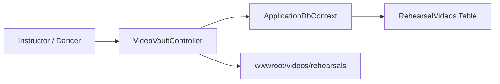

# Requirements

### Overview & Goals
The goal is to eliminate all compilation errors in `VideoVaultController.cs` to restore the functionality of the Video Vault module. Fixing these issues maximizes the utility of the dance studio portal by enabling instructors and students to upload, manage, and access rehearsal videos without system downtime.

### Scope
- **In Scope**:
  - Correcting property identifier mismatches (`UploadedAt` vs `UpLoadedAt`) in `VideoVaultController.cs`.
  - Aligning namespace definitions between `VideoVaultController.cs` and the rest of the `EatonvilleDanceStudio` project.
  - Verifying successful project compilation and test execution across `EatonvilleDanceStudio.sln`.
- **Out of Scope**:
  - Database schema alterations or EF Core migration modifications.
  - Adding new endpoints or modifying business logic outside `VideoVaultController.cs`.

### User Stories
- As a dance instructor, I want to upload and categorize rehearsal videos for my classes without build or runtime errors so that dancers can practice routines at home.
- As a dancer or parent, I want to view practice videos sorted chronologically by upload date so that the most recent choreography notes are readily accessible.

### Functional Requirements
- `VideoVaultController.Index` must successfully query and order `RehearsalVideo` entities by `UpLoadedAt` in descending order.
- `VideoVaultController.Create` must correctly construct and persist a new `RehearsalVideo` instance with its timestamp set to `DateTime.UtcNow`.
- The controller must reference the correct model properties and namespace hierarchy to guarantee flawless compilation.

# Technical Design

### Current Implementation
In `VideoVaultController.cs`:
- Line 33 calls `.OrderByDescending(v => v.UploadedAt);`
- Line 133 sets `UploadedAt = DateTime.UtcNow;`
- The file uses `namespace DanceStudioManagementPortal.Controllers` and imports `DanceStudioManagementPortal.ViewModels`.

In `EatonvilleDanceStudio/Models/RehearsalVideo.cs`:
- The entity property is declared with PascalCase `UpLoadedAt` (`public DateTime? UpLoadedAt { get; set; } = DateTime.UtcNow;`).
- Existing EF Core migrations (`AddRehearsalVideoVault.cs` and `ApplicationDbContextModelSnapshot.cs`) map column name `UpLoadedAt`.

Because C# is case-sensitive, referencing `UploadedAt` causes compilation errors `CS1061: 'RehearsalVideo' does not contain a definition for 'UploadedAt'` and inference failure on `OrderByDescending`.

### Key Decisions
- **Match Existing Model Definition**: Update controller references to use `UpLoadedAt` directly. This avoids schema migrations, maintains database backwards compatibility, and delivers immediate utility with zero regression risk.
- **Namespace Consistency**: Normalize namespace declarations to `EatonvilleDanceStudio.Controllers` and `EatonvilleDanceStudio.ViewModels` to match standard project conventions.

### Proposed Changes
- **`EatonvilleDanceStudio/Controllers/VideoVaultController.cs`**:
  - Change `v.UploadedAt` to `v.UpLoadedAt` in the `Index` action query.
  - Change `UploadedAt = DateTime.UtcNow` to `UpLoadedAt = DateTime.UtcNow` in the `Create` POST action.
  - Clean up namespace declaration to `EatonvilleDanceStudio.Controllers` and import `EatonvilleDanceStudio.ViewModels`.
- **`EatonvilleDanceStudio/ViewModels/RehearsalVideoUploadViewModel.cs`**:
  - Update namespace to `EatonvilleDanceStudio.ViewModels` if needed for standard alignment.

### Architecture Diagram

### Risks & Mitigations
- **Risk**: Renaming the property on the model instead of controller would break existing EF Core migrations and database schema mapping.
  - *Mitigation*: Adjust the controller code to strictly adhere to the existing entity definition `UpLoadedAt`.

# Testing

### Validation Approach
Verification will be executed using standard automated build and test runner commands via dotnet CLI.

### Key Scenarios
- **Compilation Check**: `dotnet build EatonvilleDanceStudio.sln` completes with 0 errors.
- **Controller Diagnostics**: Code analysis tool reports zero unresolved symbols in `VideoVaultController.cs`.
- **Unit and Integration Tests**: `dotnet test EatonvilleDanceStudio.sln` runs and passes.

### Edge Cases
- Nullable `UpLoadedAt` handling during sorting and instantiation.
- File upload path vs external URL handling in `Create` action.

# Delivery Steps

### ✓ Step 1: Fix Property Mismatches in VideoVaultController
The compilation errors in `VideoVaultController.cs` are resolved and the solution builds successfully.

- Update line 33 in `VideoVaultController.cs` to query by `v.UpLoadedAt` instead of `v.UploadedAt`.
- Update line 133 in `VideoVaultController.cs` to initialize `UpLoadedAt = DateTime.UtcNow` instead of `UploadedAt`.
- Align namespace definitions across `VideoVaultController.cs` and `RehearsalVideoUploadViewModel.cs` with `EatonvilleDanceStudio.Controllers` and `EatonvilleDanceStudio.ViewModels` to eliminate namespace divergence.

### ✓ Step 2: Verify Build and Run Test Suite
The entire solution compiles cleanly and test suites execute without errors.

- Run `dotnet build EatonvilleDanceStudio.sln` to confirm zero compilation errors.
- Run `dotnet test EatonvilleDanceStudio.sln` to verify test suite health and ensure no regressions.